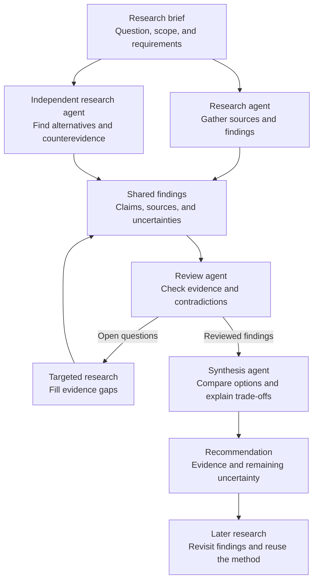

# Nulldown

**Persistent Markdown state for AI agents, applications, and collaborative workflows.**

Nulldown lets agents and applications work with Markdown as durable, versioned state—not just text passed between prompts.

An agent can read a plan, make a change, record what happened, and retrieve that information in a later session. Other agents can work from the same document without depending on the original conversation.

Nulldown provides:

- **Persistent state** — Keep documents, changes, decisions, and results beyond an agent session.
- **Structured retrieval** — Retrieve relevant sections and their source locations instead of loading entire documents.
- **Versioned changes** — Record edits as events, reconstruct previous states, and work across independent branches.
- **Reusable memory** — Preserve facts, procedures, and supporting references for later tasks.
- **Execution context** — Connect documents to agent procedures, tools, and interactive workflows.

Your existing agent framework still executes the work. **Nulldown maintains the shared state that makes the work inspectable and reusable.**

## Why Nulldown?

Consider a team of agents researching a question and preparing a recommendation.

You give them a Markdown brief:

```markdown
# Research brief

## Question
Which option best meets our requirements?

## Tasks
- [ ] Gather sources and compare the options
- [ ] Investigate alternatives and counterevidence
- [ ] Review the findings
- [ ] Write a recommendation with supporting sources

## Open questions
Which claims still need evidence?
```

One agent gathers sources and records findings. Another looks for alternatives and counterevidence. A reviewer checks their claims and identifies gaps. A synthesis agent uses the reviewed findings to explain the options and recommend a path forward.



The arrows show handoffs; your orchestrator runs the agents and coordinates writes. Nulldown preserves the brief, findings, source references, review notes, and results as the work progresses.

Tomorrow, a new agent can retrieve what was found, what is disputed, and what still needs investigation. It can inspect the evidence and continue without reconstructing the original conversation. A later task can revisit those findings and reuse a reviewed research procedure.

**Read context → perform work → record changes → retrieve and reuse.**

## How It Works

Nulldown starts with ordinary Markdown and adds a persistent state model around it. You do not need to learn a new document format to begin.

| Concept           | What it means                                                                                     |
| ----------------- | ------------------------------------------------------------------------------------------------- |
| **Document**      | Markdown content with a persistent identifier.                                                    |
| **Branch**        | An independent timeline of changes associated with a document.                                    |
| **Change**        | A recorded diff event that modifies Markdown on a branch.                                         |
| **Current state** | Markdown reconstructed from accepted changes.                                                     |
| **Snapshot**      | The exact document state at a particular point in a branch.                                       |
| **Query**         | Retrieval of relevant structure, with source ranges and ranking information.                      |
| **Publication**   | An explicit choice to update an owned document or create a new document from a reviewed snapshot. |

Branches let work evolve without immediately changing the published document. Snapshots identify particular states; queries retrieve the portions relevant to a task.

Changes can carry intent, labels, confidence, references, and explicit priority. Priority can influence authorized retrieval for the affected event. The other fields explain the action; they do not independently increase ranking or establish truth.

[Understand document state](https://nulldown.app/d/m255tk) · [Documents and changes](https://nulldown.app/d/AGJtdX)

## Connect An AI Agent

MCP is the recommended starting point for agents. Install [Bun](https://bun.sh), then the matching `0.0.9` prerelease packages:

```bash
bun install -g @thenullnode/nulldown@0.0.9 @thenullnode/nulldown-mcp@0.0.9
```

Create a dedicated credential while the MCP server is stopped:

```bash
env -u ND_TOKEN nd \
  --auth-file /absolute/path/to/nulldown-mcp-auth.json \
  auth login --name nulldown-mcp
```

Approve the login in your browser. Replace the path with an absolute path on the machine running your MCP client.

For a client using an `mcpServers` configuration:

```json
{
  "mcpServers": {
    "nulldown": {
      "command": "nulldown-mcp",
      "env": {
        "ND_BASE_URL": "https://nulldown.app",
        "ND_AUTH_FILE": "/absolute/path/to/nulldown-mcp-auth.json",
        "ND_MCP_LOG_LEVEL": "info"
      }
    }
  }
}
```

Configuration formats differ between clients. The client starts the stdio server; it is not an interactive terminal program. Give each running MCP process its own credential file because refresh tokens rotate.

Once connected, give your agent a document and a task:

> Read this research brief, identify unresolved questions, and retrieve the findings and supporting sources before continuing.

The agent can query documents, record diffs, and retrieve facts or procedures. Read tools support bounded responses; retrieve full branch content before calculating an edit.

Follow [Connect an agent](https://nulldown.app/d/NVJIa8) for a first recorded change and later-session retrieval. The [MCP package README](packages/nulldown-mcp/README.md) covers authentication, authoring configuration, tool contracts, and retries.

## Quick Start With The CLI

The published `0.0.9` prerelease is available under the npm `next` tag. This example pins that version:

```bash
bun install -g @thenullnode/nulldown@0.0.9
nd --version
```

Create an ordinary Markdown file:

```bash
cat > research-brief.md <<'MARKDOWN'
# Research brief

## Question
Which option best meets our requirements?

## Tasks
- [ ] Gather sources
- [ ] Review the evidence
- [ ] Write a recommendation
MARKDOWN
```

Store this deliberately public sample and read it back:

```bash
nd create research-brief.md --legacy-plaintext --json
nd get <document-id> --raw
```

Use the actual `id` returned by `create`; its `url` opens the document in a browser. The explicit plaintext mode makes the readback Markdown even if you already have an authoring credential. Anyone with the link can read this sample. See [Privacy and access](https://nulldown.app/d/prO0pe) for account-owned sealed documents and visibility modes.

### Edit And Query A Branch

Authenticate and keep the root and branch identifiers returned by resolution:

```bash
nd auth login
nd branch resolve <document-id> --json
nd branch content <root-id> <branch-id> --json
nd branch query <root-id> <branch-id> --query "open questions" --top 3 --json
```

Use queries to locate relevant passages. Read full current content when you need to inspect the whole document or prepare an edit.

Put your revised Markdown in `edited.md`, then record the change:

```bash
nd diff replace <root-id> --branch <branch-id> --to-file edited.md --json
nd branch content <root-id> <branch-id> --json
```

Check the resulting content. The original document URL does not automatically change when its branch advances.

### Publish Reviewed State

In the published `0.0.9` CLI, promotion creates a new document from the reviewed branch snapshot:

```bash
nd branch promote <root-id> <branch-id> \
  --expected-snapshot <snapshot-id> \
  --idempotency-key <unique-key> --json
```

Use the snapshot you reviewed and retain the same snapshot/key pair for a retry of that publication. Inspect the returned destination URL afterward.

Updating an existing owned document requires ownership of the destination. The published `0.0.9` CLI exposes revision-safe `nd update`, but the current hosted service rejects direct replacement once an owner branch exists with `owner_branch_publication_required`.

For an owner branch, use a client built from current source. Read the root revision and intended snapshot, then publish with:

```bash
nd branch publish <root-id> \
  --expected-snapshot <snapshot-id> \
  --expected-revision '<etag>' \
  --idempotency-key <unique-key>
```

The corresponding MCP tool is `branch_publish`, with `rootId`, `expectedSnapshotId`, `expectedRevision`, and `idempotencyKey`. Reuse all three intent fields when retrying a lost response, then verify the destination with `drop_get`. These publication commands are present in current source but not in the published `0.0.9` packages. See the [CLI and HTTP API reference](docs/NULDOWN_API.md) for contracts matching your installation.

For sealed documents, `nd get --raw` returns the stored envelope rather than decrypted Markdown. Use the appropriate browser or branch-content access path to inspect readable content.

## What Can You Build?

- **Long-term memory:** save findings, decisions, and procedures with supporting references, then check their freshness in a later session. [Memory walkthrough](https://nulldown.app/d/2jvr1e).
- **Multi-agent coordination:** share plans and recorded results between researchers, reviewers, and writers. [Agent workflow](https://nulldown.app/d/J8V2nm).
- **Collaborative Markdown:** inspect recorded edits and previous states, and recover conflicting work before publication. [Collaborative editing](https://nulldown.app/d/SEbKiW).
- **Reusable procedures:** retrieve a method, execute its steps using your tools, and record fresh outcomes. [Procedure walkthrough](https://nulldown.app/d/6Cy3H4).
- **Document-driven interfaces:** put reviews, approvals, and interactions beside the content they operate on. [Document interfaces](https://nulldown.app/d/NyInTa).

## FAQ

### How Is Nulldown Different From An Agent Skill?

A skill packages reusable instructions, scripts, and resources. Nulldown preserves the evolving state of the work performed using those instructions.

A research skill can explain how to find and evaluate sources. Nulldown can hold this investigation's question, findings, evidence, review notes, and unresolved issues. Another session can retrieve that state and continue.

They work together: a skill can use Nulldown to retrieve context, record outcomes, and retain a reviewed method as a reusable procedure.

### Why Not Just Keep Markdown In Git?

Git already provides durable files, history, and branches. Nulldown adds document-oriented access for agents: focused queries with source ranges, attributed edits, and branch-scoped facts and procedures. It is useful when you want those operations available directly to a workflow.

### How Does It Compare With Agent Memory Tools?

There is overlap. Nulldown connects reusable memory to readable documents and their evolving state. Findings and procedures can retain references to the evidence they came from, so people and agents can inspect and revise the knowledge they reuse.

### How Does It Relate To RAG And Vector Databases?

RAG retrieves context for a model; a vector database can help find similar content. Nulldown maintains document state and exposes structural queries, source ranges, changes, and memory. Its documented structural retrieval does not require a vector database. Choose a separate semantic-search system when your application needs that retrieval method.

### Does It Replace An Agent Framework?

Your framework assigns roles and runs agents. Nulldown supplies the plans, procedures, results, and handoffs they use to coordinate and resume work.

### What Does Executable Markdown Mean?

An agent retrieves a procedure, invokes the required tool, checks the outcome, and records the result. Supported document blocks also provide runtime-backed interactions. Ordinary prose does not execute by itself.

### Can Multiple Agents Edit Simultaneously?

Agents can contribute recorded changes, but concurrent writes still need coordination. The editor can block syncing when remote changes arrive over pending local edits. Separate branches remain independent; automatic conflict-free convergence and automatic branch merging are not current guarantees.

### Does Stored Memory Mean Verified Knowledge?

A stored finding remains a claim supported by its evidence. Freshness, confidence, and ranking help agents inspect context; none proves a conclusion true. Later sessions should check whether a finding still applies.

### When Is Nulldown Unnecessary?

For a static document or a one-off task, a Markdown file may be enough. Nulldown becomes useful when work must survive conversations, pass between agents, retain evidence, or become reusable knowledge.

## Ways To Use Nulldown

Choose the surface that fits your work:

| Need                            | Start with                                              |
| ------------------------------- | ------------------------------------------------------- |
| Read and author documents       | [nulldown.app](https://nulldown.app)                    |
| Automate documents and branches | [CLI and API guide](docs/NULDOWN_API.md)                |
| Connect an agent                | [MCP server](packages/nulldown-mcp/README.md)           |
| Run a local API                 | [Self-hosting](#self-host)                              |
| Understand the model            | [Nulldown documentation](https://nulldown.app/d/kzgJGL) |

For public discovery, see the [search API reference](docs/NULDOWN_API.md#get-apisearch). Its backend controller and repository live in `functions/api/_lib/search/`.

Portable contracts and codecs live under `shared/`. Public package imports are defined by the export map in `package.json` and can differ from source filenames.

## What Exists Today

| Area                 | Current capability                                                                                                                                      |
| -------------------- | ------------------------------------------------------------------------------------------------------------------------------------------------------- |
| Deterministic state  | Ordered branch diff events, parent-linked snapshots, checkpoints, replay, and promotion.                                                                |
| Retrieval and memory | Structural document/runtime queries, source references, priority overlays, and optional NullMem facts, procedures, capabilities, and freshness signals. |
| Interfaces           | Native Nulldown composition, nullplug runtime contracts, runtime facts, and policy-controlled proposed mutations.                                       |
| Trust                | Public plaintext, client-sealed, provider-assisted, and self-hosted workflows with different explicit trust properties.                                 |
| Account continuity   | OpenAuth can bind a current V1 account and store a browser-encrypted key package for recovery of known private links on another signed-in browser.      |
| Deployment           | Cloudflare Pages/R2/D1 plus a self-hostable Bun API backend using filesystem blobs and SQLite metadata.                                                 |

## Drop Providers and Nullplug

Browser drop storage and Nullplug invocation use separate capabilities. `DropProviderPortRegistry` routes local and remote drop operations, while `BrowserNullplugClient` owns editor-session invocation and branch fact submission. Backend composition is exposed independently through `NulldownServerRuntime` from `@thenullnode/nulldown/server/runtime`.

Remote manifests declare the versioned invocation media type `application/vnd.nulldown.nullplug.invoke+json;version=1`. Provider invocation rechecks the endpoint allowlist, narrows capabilities to the manifest permissions, enforces a timeout and response-size limit, and rejects non-conforming responses. It never imports code from manifest URLs.

## Authoring And Reliability

Hosted branch writes require appropriate account authorization. CLI login stores a refreshable credential in the private Nulldown configuration directory. `ND_ACCOUNT_ID` is only for local development against a server that explicitly enables its insecure account header.

An authoring-capable login seals authenticated `create` and `update` content in
the CLI before it is sent to the API. Use `--visibility private|unlisted|public`
to select sharing behavior; it defaults to `unlisted`. Private drops are
vault-only, while unlisted and public drops use provider escrow for recovery.
The CLI reads the public `VITE_PROVIDER_ENCRYPTION_PUBLIC_JWK` setting for that
escrow path and never needs a provider private key. Older credentials must run
`nd auth login` again before account-owned authoring. Use `--legacy-plaintext`
only for intentional compatibility: it stores plaintext and does not enter
Remote Library.

MCP integrations can seal account-owned drops through the stable root export:

```ts
import {
  sealDropForAuthoring,
  type AccountEncryptionMaterial,
  type DelegateSigningMaterial,
  type ProviderEncryptionMaterial,
  type SealDropForAuthoringInput,
} from "@thenullnode/nulldown/drop/authoring";
```

Use `--no-browser` to print the verification URL and authorization code
without opening it. Set
`ND_AUTH_FILE` or pass `--auth-file` to select another credential file. Direct
`--token` and `ND_TOKEN` values still take precedence over the stored CLI
credential.

When retrying `nd diff apply` after an ambiguous network failure, reuse both the
original event identity and creation time. A successful response includes the
durable event receipt; do not retry with a new identity until the original outcome
is known. For a generated `diff replace`, save the generated envelope and retry it
with `diff event` or `diff batch`; replacement re-computes its operations from live
branch content and is not an exact replay surface.

```bash
nd diff apply <rootId> --branch <branchId> --event-id retry-1 --created-at 1770000000000 --insert '0:retry' --json
```

Run against a local or preview API:

```bash
nd --base=http://127.0.0.1:8788 get <id> --json
```

`diff_apply` accepts event metadata alongside the Markdown operations. Use `intent`, `labels`, `confidence`, and references to preserve action context. An explicit numeric `args.priority` can create a diff-linked priority fact; include the acknowledged event sequence in a later `branch_query` range when that priority should participate in document ranking.

## Documentation

### Operational telemetry

Optional bounded request profiling, protocol compatibility and the local
baseline/profile/compare workflow are documented in [Observability](docs/OBSERVABILITY.md).
Run `bun run test:profiling` for current-tree native fixture coverage; all profiling
flags remain deployment-owned and default off.

The API middleware emits request summaries to the private `nulldown-telemetry`
Worker through the `TELEMETRY` service binding. Deploy the collector with
`bunx wrangler deploy --config packages/nulldown-telemetry/wrangler.jsonc`
before deploying the Pages application that uses it.

API responses include `x-request-id` and `x-operation-id` for investigation.
Browser diagnostics cover API outcomes, session checks, errors, and new draft
entries. Events contain allowlisted metadata, not document text or credentials.
Browser reports are best-effort, bounded, rate-limited, and labeled separately
from server observations. Query `nulldown-telemetry` in Workers Logs by
`operationId` to connect a page visit to its server requests. Retention follows
the account's Workers Logs limits; this collector does not provide an archive.

Typecheck the collector with
`bunx tsc --project packages/nulldown-telemetry/tsconfig.json`.

The canonical conceptual documentation lives in Nulldown:

- [Documentation index](https://nulldown.app/d/kzgJGL)
- [Why Nulldown](https://nulldown.app/d/TQHCCo)
- [Understand document state](https://nulldown.app/d/m255tk)
- [Work with Nulldown as an agent](https://nulldown.app/d/J8V2nm)
- [Use documents as interfaces](https://nulldown.app/d/NyInTa)
- [Privacy and access](https://nulldown.app/d/prO0pe)
- [Connect an agent](https://nulldown.app/d/NVJIa8)
- [Documents and changes](https://nulldown.app/d/AGJtdX)
- [Choose an interface](https://nulldown.app/d/VD4rpR)
- [Research and review handoff](https://nulldown.app/d/i9Vy4Z)
- [Build a research and review briefing](https://nulldown.app/d/vt2gr7)
- [Project status](https://nulldown.app/d/XG80QG)

The local [`docs/`](docs/README.md) directory contains source-coupled API and operational references.

`strategy_get` (SDK: `client.readStrategy`) uses an explicit `branchId` without
reading the root. Otherwise it reads the root once and follows plaintext payload
metadata `strategyRef: { kind: "branch", rootDropId: "<canonical same root>", branchId: "<explicit branch>" }`.
Both ids must be nonempty trimmed strings. Short input ids are checked against the
canonical id returned by the root read. Explicit branch responses must match the requested canonical root or its
six-character short alias. Without a reference it stays a labeled root
read; `query`, `snapshotId` and `top` require an explicit or metadata-selected branch.
Reads never resolve/create branches, follow references recursively, or fall back
after invalid/cross-root references or branch errors. Routing is not authorization.
Envelope metadata is not followed and no secrets are decrypted. Existing drops are
not migrated: publishing a branch and revision-safely updating its original root's
metadata are separate explicit actions; preserve the root content and other metadata.
Output defaults to 800 approximate tokens (`maxTokens`, 100-8000), bounded to
`maxTokens * 4` serialized characters even with `format: "full"` or `preview: false`.
Root/branch/snapshot identity, partial/truncated flags and requery guidance survive
payload truncation. `getDrop` / `drop_get` remain the raw root read interfaces.

New committed branch snapshots carry an authoritative `sourceContentHash` in
snapshot JSON. Document queries can reuse a matching current-version projection
without replaying content. Missing or stale projections reconstruct and validate
the source before repair; inconsistent authoritative hashes fail explicitly.
Legacy snapshots and mutable snapshot zero still reconstruct on every query,
without writing hashes back. Runtime fact freshness and per-query priority reads
remain independent of document projection reuse. No database migration is required.

Resolved queries and updates check root plaintext-read permissions before using
cached or regenerated heaps. Private and account-vault-only envelopes require the
root owner's authenticated session. Runtime projections additionally require the
branch owner or writer; rebuild requests reject client-supplied runtime fact arrays
and use facts persisted through the state/submit endpoints.

## Interactive Approval

An authenticated remote branch can render a built-in approval nullplug in the editor:

````markdown
```approval(id="research-review")
Approve this briefing after checking its supporting sources?
```
````

The `id` is required and should remain stable. Submitting the form stores an immutable, actor-attributed `ui.response` fact and rebuilds the branch runtime-reference heap. Agents can retrieve the decision with MCP `branch_query` using resolver `nulldown.resolved.runtime-refs`, kind `ui.response`, and primitive id `research-review`. Approval responses never apply document diffs or mint runtime authority by themselves.

## Self-Host

Run the API locally with filesystem blob storage and SQLite metadata:

```bash
nd serve --host 127.0.0.1 --port 8788 --data-dir .nulldown-data
```

The local SQLite runner records successful migration files transactionally, so
restarts do not repeat account-schema alterations. Its startup `migrationsApplied`
list contains only files applied during that invocation.
For databases created before the migration ledger, existing DDL is adopted only
after matching its stored schema definition. Missing statements still execute;
incompatible definitions fail and roll back that migration rather than being marked applied.

Run the same API in Docker with `/data` as the persistent volume:

```bash
docker build -t nulldown .
docker run --rm -p 8788:8788 -v nulldown-data:/data nulldown
```

The local server supports core drop, branch, diff, resolved-query, priority, and NullMem routes. It is a self-hostable API backend, not a full packaged replacement for every hosted route or the web application.

## Development

Install dependencies:

```bash
bun install
```

The root-only `@thenullnode/nulldown: file:.` override links MCP to this checkout.
It does not replace the MCP package's consumer
dependency range; installed-pair verification supplies both exact tarballs.

Run the Vite development server:

```bash
bun run dev
```

Run Cloudflare Pages development with Functions:

```bash
bun run pages:dev
```

Run focused verification:

```bash
bun run test
bun run build
bun run cli:build
bun run package:check-cli
bun run package:check-mcp
```

### Quality checks

Run the local checks before submitting changes:

```bash
bun run format:check
bun run lint
bun run typecheck
bun run test --runInBand
```

`bun run typecheck` checks the web app, Functions, tooling, MCP, shared code,
configuration, OpenAuth, and tests as separate TypeScript surfaces. Run the
individual `typecheck:<surface>` scripts when you need diagnostics for one area.

## Contributing

Production browser builds load public provider keys from `.env.production`.
The matching private keys belong in Cloudflare Pages secrets, never in a `VITE_`
variable. Local `.env.*.local` files can override the public build configuration.

Repository rules live in [AGENTS.md](AGENTS.md). Nulldown-hosted plans, documentation, and agent memory are updated with branch diffs and verified through resolved queries. The local [`docs/`](docs/README.md) directory retains source-coupled references and migration material; the hosted documentation graph is the public conceptual source of truth.

### Runtime internals

Branch timeline lookup, actor resolution, snapshot reads, and heap maintenance
route through `src/server/state-plane/gateway.ts`. Its request-scoped capabilities
delegate to the existing branch services through a legacy adapter, retaining blob
storage, optional SQL projections, and replay fallbacks.

Diff transport uses the same gateway for append and polling capabilities. Append
commands retain the existing Nulledit commit service and durable receipts.
NullMem record persistence uses `src/server/stores/nullmem-record-store.ts`, whose
query, write, and delete capabilities bind their value type to validated NullMem
records.

Resolved queries emit content-free `resolved.heap.phase` timing logs with request
and phase identifiers. Query totals and projection generation are logged at
`info`; `LOG_LEVEL=debug` adds read, replay, authorization, and ranking phases.
Projection write phases report attempted/completed statement counts and available
D1 SQL duration. Phase durations include nested work, so do not sum them; SQL
duration excludes network time.

For runtime diff operations, [`DropDiffOperation`](shared/drop/diff-operation.ts)
provides validated factories and defensive copies of editor buffers and records.
Use `fromDiff()` for editor operations, `fromRecord()` for incoming records, and
`toRecord()` at transport and persistence boundaries. The existing v1 wire format
is preserved.

### Local transactional State Plane

`src/server/state-plane/sqlite-commits.ts` provides single-event and atomic batch
append, head, exact-version content, and bounded event-range reads. Events, snapshots, heads,
immutable receipts, and outbox records commit in one SQLite transaction. A bounded
exact-version cache reuses content while durable reads check placement and identity.

`packages/nulldown-state-plane` adapts this port to SQLite-backed Durable Objects
and internal RPC, using a fixed 16-shard routing layout. HTTP, MCP, and CLI use the
legacy backend by default. The local Worker has no public state endpoints; fixture
seeding requires an explicit test binding. Migration and outbox consumers are not
implemented.

For local application testing, `src/server/state-plane/commit-application.ts`
connects explicitly seeded branches to the existing authenticated diff and content
routes. Public batches share one snapshot and retain per-event retry acknowledgements.
Selection is an in-process dependency, not a request header or deployment variable.
Lifecycle, snapshot listing, runtime facts, memory, and plugin operations remain
unsupported on this local path. Snapshotters must be supplied explicitly with a
derived-data store; durable outbox delivery is separate work.

With Bun and a Node.js version supporting `node:sqlite`, run:

```bash
bun run test:state-plane
bun run test:state-plane:native
bun run test:state-plane:application
bun run typecheck:state-plane
```

The application harness runs two clients through HTTP, the application routes,
the Worker service binding, and SQLite Durable Objects. It exercises batch edits,
authorization, lost-response retries, reconnects, and restarts on disposable local
storage. The native storage harness tests the lower-level commit boundary.

Regenerate Worker types after configuration changes with
`bun run --cwd packages/nulldown-state-plane types`.

## License

MIT
